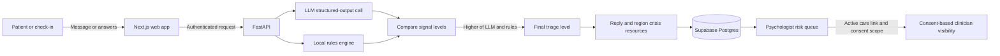

# MindCare AI

Between-session mental-wellness support for patients and consent-based
visibility for linked psychologists.

[](https://github.com/kxshith21/MindCare-AI-Intelligent-Mental-Health-Monitoring-System/actions/workflows/ci.yml)


> **Prototype / portfolio project. Not ready for real patients until the launch
> checklist in [docs/LAUNCH_CHECKLIST.md](docs/LAUNCH_CHECKLIST.md) is complete.**

## The problem and the idea

Mental-health support is often intermittent: people may need reflection,
check-ins, or clear next steps between appointments. MindCare AI provides
patient-owned mood check-ins, PHQ-9/GAD-7 questionnaires, and AI-assisted
reflection chat as low-cost support tools rather than a replacement for
professional care.

With consent, a patient can link a psychologist and choose a summary-only or
full sharing scope. Linked psychologists can see relevant trends and a
triage-signal queue, while RLS and active-care-link rules restrict access.

MindCare AI is not therapy, a clinical assessment service, or a crisis service.
Risk flagging is a triage signal that can be wrong or miss things.

## Screenshots and demo

<!-- TODO: Capture these screenshots in a local/staging session.
Add chat.png, check-in.png, patient-dashboard.png, and psychologist-dashboard.png
under docs/screenshots/. Avoid real patient data and redact all identities. -->

| Chat | Check-in |
|---|---|
|  |  |

| Patient dashboard | Psychologist dashboard |
|---|---|
|  |  |

## Features

### Patient

- Supabase-authenticated accounts with a patient role and personal data views.
- Mood check-ins with server-computed PHQ-9 and GAD-7 totals.
- Recharts-based personal trends from check-in scores and mood values.
- AI reflection chat with a provider-agnostic LLM and structured response schema.
- Consent-based invitations for verified psychologists.
- Share scope control: `summary_only` or `full`.
- Delete-my-data flow that removes patient-owned app data and anonymizes audit identity.
- Region-aware crisis resources for chat and check-in triage paths.

### Psychologist

- Server-assigned psychologist role and a separate verification record.
- Consent-based patient links with pending, active, and revoked states.
- Patient overview and check-in trends restricted to active care links.
- Risk-event queue for elevated or high triage signals.
- Private clinician notes for an active linked patient.
- Access audit log that records psychologist reads.

### Safety and privacy

- Role from Supabase `app_metadata`, never browser-supplied `user_metadata`.
- Row Level Security on application tables; `anon` has no table privileges.
- Active care links and consent scopes control psychologist access.
- `summary_only` hides check-in notes, raw answers, and chat text.
- `full` exposes additional content only after the patient chooses that scope.
- Revoking a care link is terminal and removes future access.
- Independent rules engine plus LLM structured output; final level is the higher
  of the two signals.
- PHQ-9 item 9 has a separate server-side elevated/high trigger path.
- LLM timeout, malformed output, or provider failure uses the rules engine and
  safe canned replies.
- `CHAT_ENABLED=false` short-circuits chat and returns crisis resources.
- No outbound email/SMS, medication advice, or treatment-plan generation.
- Message text goes to the configured third-party LLM provider; raw chat content
  is not written to application logs.

## How it works



Every chat signal is imperfect: the model and rules can both produce false
positives or miss important context. The queue is for human review, not
automated action.

## Tech stack

| Layer | Technology | Why |
|---|---|---|
| Frontend | Next.js 16 App Router, TypeScript, Tailwind, shadcn/ui | Typed routes and UI components in a server/client split |
| Charts | Recharts | Check-in-only trends from real stored values |
| Backend | FastAPI, Pydantic v2, Python 3.11+ | Validated APIs and structured LLM output |
| AI | Provider-agnostic OpenAI-compatible client | Server-side provider/key configuration |
| Database/auth | Supabase Postgres, Auth, Row Level Security | Token auth and database-enforced access boundaries |
| CI | GitHub Actions, pytest, Vitest, Playwright, Supabase CLI | API, frontend, RLS, and browser coverage |
| Hosting target | Vercel for web; Railway or Render for API | Separate frontend and backend deployment |

## Safety and privacy design

- Consent scopes are `summary_only` and `full`; pending/revoked links grant no
  patient-data access.
- RLS is enabled on every application table. The service role is used only in
  approved server-side paths, never by browser code.
- The role claim comes from trusted `app_metadata`; `user_metadata.role` is
  ignored.
- Every psychologist data read appends an access row to `audit_log`.
- Patient deletion removes app-owned records through `delete_my_data()` and the
  API account path.
- Application-level encryption of message and journal text is not implemented
  yet; this is a launch blocker.
- Crisis numbers and URLs can change and must be re-verified. Provider terms,
  retention, and processing-region details must also be reviewed.

See [docs/RISK.md](docs/RISK.md) for triage behavior and
[docs/RLS.md](docs/RLS.md) for the authorization matrix.

## Getting started

### Prerequisites

- Git
- Node.js 22 (matching CI)
- Python 3.11+
- Docker Desktop
- Supabase CLI

See [docs/ENV.md](docs/ENV.md) before setting environment variables.

1. Start and seed local Supabase:

   ```bash
   cd supabase
   supabase start
   supabase db reset
   ```

   Never run `supabase db reset` or load `seed.sql` against a hosted project.

2. Configure the API:

   ```bash
   cd api
   Copy-Item .env.example .env
   python -m venv .venv
   .\.venv\Scripts\Activate.ps1
   python -m pip install -r requirements.txt
   ```

   Copy local values from `supabase start` into [api/.env.example](api/.env.example).
   For offline development use `LLM_PROVIDER=fake`; real provider keys stay
   server-side.

3. Configure the web app:

   ```bash
   cd web
   Copy-Item .env.example .env.local
   npm ci
   ```

   Set `NEXT_PUBLIC_SUPABASE_URL`, `NEXT_PUBLIC_SUPABASE_ANON_KEY`, and
   `API_URL` from [web/.env.example](web/.env.example).

4. Run the API and web app in separate terminals:

   ```bash
   cd api
   uvicorn app.main:app --reload --port 8000
   ```

   ```bash
   cd web
   npm run dev
   ```

   Open `http://localhost:3000`.

### Tests

Run from the repository:

```bash
cd api
python -m pytest -q
```

Run frontend checks:

```bash
cd web
npm run typecheck
npm run lint
npm test
npm run build
npm run test:e2e
```

Run RLS tests from `/supabase` after `supabase start`:

```bash
supabase db reset
docker cp tests/rls_test.sql <database-container>:/tmp/rls_test.sql
docker exec <database-container> psql -U postgres -d postgres -v ON_ERROR_STOP=1 -f /tmp/rls_test.sql
```

The CI container name is generated for the runner. On this local stack, inspect
it with `docker ps --format '{{.Names}}'` and replace `<database-container>`.

## Project structure

```text
web/          Next.js frontend, server BFF route, and frontend tests
api/          FastAPI routes, Pydantic schemas, services, and pytest suite
supabase/     Migrations, seed data, RLS tests, and verification SQL
docs/         Architecture, data model, security, deploy, and launch records
.github/      CI and manual/nightly Playwright workflows
scripts/      Remote smoke helper
legacy/       Frozen Flask/SQLite prototype; reference only
```

## Testing

- **API:** pytest coverage includes chat, auth, account deletion, check-ins,
  psychologist access, crisis resources, risk rules, LLM fallback, and logging.
- **Risk rules:** an 83-case labeled set covers false negatives and false positives.
- **Crisis resources:** tests require non-empty region fallbacks and verify
  response shape.
- **Frontend:** Vitest covers API utilities, route guards, signup, legal pages,
  disclaimer/footer resources, and dashboard output.
- **RLS:** 14 scripted SQL scenarios assert role isolation, consent scopes,
  pending/revoked links, deletion, computed scores, and consent metadata.
- **Browser:** Playwright has patient and psychologist flows in `web/e2e/`.
- **CI:** GitHub Actions runs API tests, frontend unit/lint/type/build checks,
  RLS tests, and gitleaks. The Playwright workflow is manual/nightly.

The current rule set needs clinician review and native-speaker review,
especially for Hinglish/transliterated language. Automated tests do not prove
real-world safety, clinical suitability, or legal compliance.

## Roadmap and known limitations

The launch blockers and rollout gaps are tracked in [docs/TODO.md](docs/TODO.md).
Before real use, the project still needs:

- Clinician review of the risk rules, prompt, check-in copy, and crisis screens.
- Native-speaker review of regional-language patterns.
- Re-verification and dating of every crisis number and URL.
- Legal and LLM-provider terms review.
- Application-level encryption for message and journal text.
- Separate staging and production Supabase projects, backups/PITR, and restore testing.
- A repeatable psychologist license-verification process.
- Incident ownership and a tested chat kill switch.
- A shared-store chat rate limiter instead of the process-local in-memory limiter.
- Metrics and alerts for LLM failures, elevated 5xx rates, and risk-event volume.
- Age verification beyond the current 18+ self-attestation.
- Accessibility, i18n/localization, retention/deletion policy, and backup drills.

## Evolution of this project

The repository began as a Flask and SQLite prototype with no authentication,
shared conversation storage, and synthetic dashboard metrics. The migration
removed that prototype from the active architecture rather than incrementally
preserving unsafe behavior.

The current system separates Next.js, FastAPI, Supabase, and provider-specific
AI configuration. It also replaces shared data and synthetic indicators with
RLS-protected patient records, real check-in values, consent-based sharing,
and a review queue. See [docs/AUDIT.md](docs/AUDIT.md) for the engineering audit
and porting decisions.

## Crisis note

If you or someone you know is in immediate danger, contact local emergency
services. If you're in India, Tele-MANAS: 14416. In the US, call or text 988.

Crisis resources are local product fallbacks and public information. Re-verify
every number and URL before launch; they can change.

## License and contact

License: TBD. No LICENSE file is committed yet.

Use GitHub Issues for project feedback or open questions. Public issue and
deployment contact details have not been configured.
