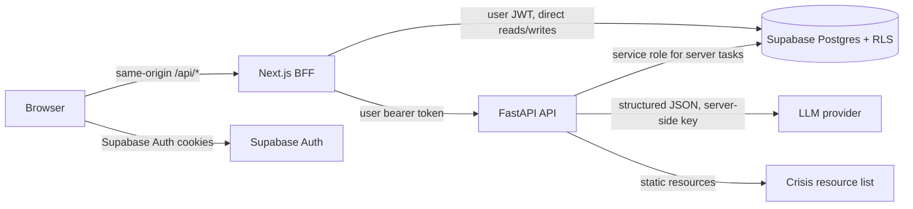

# MindCare AI

> **PROTOTYPE — NOT READY FOR REAL PATIENTS.** The launch gate in
> [`docs/LAUNCH_CHECKLIST.md`](docs/LAUNCH_CHECKLIST.md) is incomplete. Do not
> use this app with real patients until every item is ticked.

MindCare AI is a between-session mental-wellness prototype. It gives patients
mood check-ins, supportive AI chat, and their own trends. It gives linked
psychologists consent-based visibility into a patient's progress and a review
queue for risk flags.

**It is not therapy, not a clinical assessment service, and not a crisis
service.** It must never be used to keep someone safe. If there is immediate
danger, contact local emergency services or a crisis line.

The former Flask + SQLite prototype is frozen in [`legacy/`](legacy/) as a
reference only; see [`docs/AUDIT.md`](docs/AUDIT.md). Source files in `legacy/`
are never edited.

## Current status

Phases 0–4 are implemented and tested. Phase 5 adds deploy/CI documentation,
a small set of operational controls, and draft legal/info pages. The launch
gate remains open.

Implemented and tested:

- Supabase Auth with server-controlled `patient` / `psychologist` roles.
- Cookie-only browser sessions through `@supabase/ssr`; no browser token
  storage and no service-role key in `web/`.
- Patient dashboard, chat, PHQ-9/GAD-7 check-ins, care-team invitations,
  share-scope control, settings, and account deletion.
- Psychologist dashboard, risk queue, per-patient trends, and private clinician
  notes.
- Consent-based care links with `pending`, `active`, and `revoked` statuses.
- A provider-agnostic LLM service with structured output and a local rules
  engine as an independent second signal.
- Risk events visible to linked clinicians; no outbound email or SMS.
- Crisis resources rendered even when other UI fails.
- `CHAT_ENABLED=false` kill switch, DB-aware `/health`, structured logs,
  signup consent capture, and draft `/privacy`, `/terms`, and `/safety` pages.

Not implemented: clinical assessment or treatment advice, medication advice,
crisis dispatch, automatic alerts, invented scores, i18n, application-level
message encryption, or a shared-store rate limiter.

## Architecture



The browser never calls FastAPI directly and never sees the service-role key.
The Next.js route handler is an explicit allowlist; see
[`docs/FRONTEND.md`](docs/FRONTEND.md).

## Stack

| Layer | Technology |
|---|---|
| Frontend (`/web`) | Next.js 16 App Router, TypeScript, Tailwind CSS, shadcn/ui, Recharts |
| Backend (`/api`) | FastAPI, Pydantic v2, Python 3.11+ |
| Database and auth (`/supabase`) | Supabase Postgres, Supabase Auth, Row Level Security |
| AI | OpenAI-compatible chat completions via a provider-agnostic service layer |
| Hosting target | Vercel for `/web`; Railway or Render for `/api` |

## Local setup

Prerequisites:

- Node.js 20+
- Python 3.11+
- Docker Desktop (for local Supabase)
- Supabase CLI
- Git

1. Start local Supabase from `/supabase`:

   ```bash
   cd supabase
   supabase start
   supabase db reset
   ```

   `supabase db reset` applies migrations 0001–0012 plus the Phase 5 consent
   migration and loads `seed.sql`. Never load `seed.sql` into a remote project.

2. Configure the API:

   ```bash
   cd api
   cp .env.example .env
   python -m venv .venv
   # Windows: .venv\Scripts\activate
   # macOS/Linux: source .venv/bin/activate
   pip install -r requirements.txt
   ```

   Use these local values in `api/.env`:

   ```text
   SUPABASE_URL=http://127.0.0.1:54321
   CORS_ORIGINS=http://localhost:3000
   LLM_PROVIDER=fake
   LLM_API_KEY=
   ```

   Copy the local anon key and service-role key printed by `supabase start`
   into `api/.env`. The service-role key is server-only.

3. Configure the web app:

   ```bash
   cd web
   cp .env.example .env.local
   npm ci
   ```

   In `web/.env.local`, set:

   ```text
   NEXT_PUBLIC_SUPABASE_URL=http://127.0.0.1:54321
   NEXT_PUBLIC_SUPABASE_ANON_KEY=<local anon key>
   API_URL=http://localhost:8000
   ```

4. Start the API and web app in separate terminals:

   ```bash
   cd api
   uvicorn app.main:app --reload --port 8000
   ```

   ```bash
   cd web
   npm run dev
   ```

Seed logins (password `demo-password-123`):

| Role | Email |
|---|---|
| Patient with active link | `patient.one@demo.test` |
| Patient with pending invite | `patient.two@demo.test` |
| Verified psychologist | `dr.verified@demo.test` |
| Unverified psychologist | `dr.unverified@demo.test` |

## Tests

From `api/`:

```bash
python -m pytest -q
```

From `web/`:

```bash
npm run typecheck
npm run lint
npm test
npm run build
npm run test:e2e
```

From `/supabase`, with Docker running:

```bash
supabase db reset
```

RLS expectations live in `supabase/tests/rls_test.sql`; the reset flow runs
them. See [`docs/FRONTEND.md`](docs/FRONTEND.md) for frontend verification
notes and [`docs/DEPLOY.md`](docs/DEPLOY.md) for deployment checks.

Commands were run locally in the Phase 5 working tree. A pristine-clone
reinstall, remote deploy steps, and remote Supabase verification were not run;
see the final Phase 5 report for the exact verified/unverified list.

## Repository layout

```text
/web          Next.js frontend, including BFF route handlers
/api          FastAPI backend, schemas, services, and tests
/supabase     Migrations, seed data, RLS tests, and verification SQL
/legacy       Frozen Flask + SQLite prototype — reference only
/docs         Audit, data model, RLS, env, deploy, risk, security, launch gate
/.github      CI, Dependabot, and manual e2e workflow
/scripts      Remote smoke helper
```

## Limitations

- This is a prototype, not a clinical product.
- Risk output is an imperfect triage signal for human review; it can miss
  signals and can produce false positives.
- The chat rate limiter is in-memory and per API instance.
- Message and journal text is not encrypted at the application level.
- Psychologist verification is currently a manual SQL step.
- Accessibility, i18n, backup restore, incident ownership, and applicable-law
  review remain open.
- Local seeded crisis contacts are date-stamped and must be re-verified before
  any real use.

See [`docs/TODO.md`](docs/TODO.md) for blockers and follow-ups.
