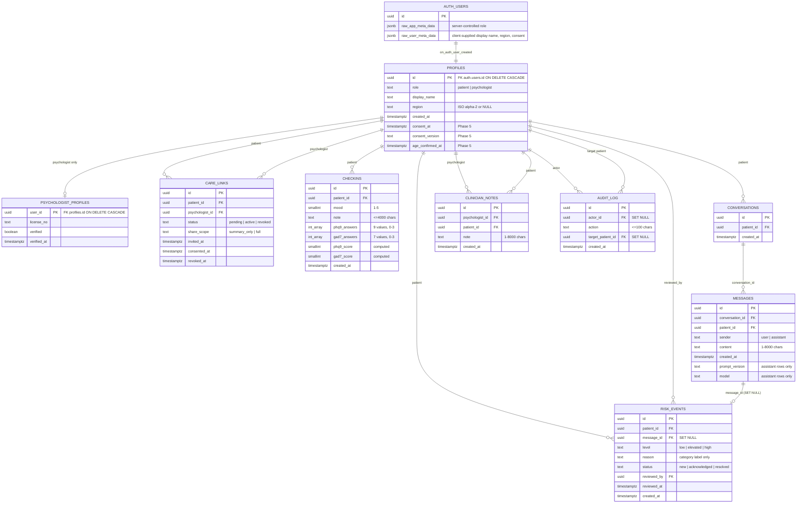

# Data model

This document reflects the migrations in `supabase/migrations/` in order,
including `20261127000001_consent.sql`. All application tables live in
`public`. RLS is enabled on every one; see [`RLS.md`](RLS.md) for the policy
matrix. Supabase Auth remains authoritative for identities and roles.

## Entity relationship diagram

## Tables and constraints

### `profiles`

One row per Auth user. `id = auth.users.id` with `ON DELETE CASCADE`. `role`
comes from `raw_app_meta_data->>'role'`, never from user metadata; a client
signup becomes `patient`. `display_name` is 1–120 characters; `region`, when
present, is normalized to a two-letter uppercase code.

Phase 5 adds optional consent columns: `consent_at`, `consent_version`, and
`age_confirmed_at`. They are stamped once by `handle_new_user()` when signup
metadata carries the corresponding acknowledgments. Existing users and
server-created psychologist accounts keep `NULL` values; signup is never
blocked by missing consent metadata. `profiles_before_update()` makes these
columns immutable. Clients have only column-level `UPDATE` on `display_name`
and `region`.

### `psychologist_profiles`

Primary key `user_id`, a cascade FK to `profiles.id`. `license_no` is 1–64
characters. `verified` defaults to `false`; only trusted SQL/service-role
actors can change it. `verified_at` records the manual verification time.

### `care_links`

A consent-based pair of patient and psychologist profiles. Status is
`pending`, `active`, or `revoked`; scope is `summary_only` or `full`.
`consented_at` records when the invitation was created; `revoked_at` is
required when status is `revoked`. No self-links are allowed. A unique partial
index allows at most one live (`pending`/`active`) link per pair; a revoked
link can be replaced by a new invitation.

`care_links_before_update()` enforces: psychologist-only acceptance, revocation
by either party, patient-only scope changes, separate scope/status changes,
and a fully frozen row after revocation.

### `checkins`

Patient-owned mood entries. `mood` is 1–5. A note is optional and capped at
4000 characters. `phq9_answers`, when present, must contain exactly nine
integers from 0 to 3; `gad7_answers` must contain exactly seven. Scores are
recomputed by `checkins_compute_scores()` from the raw answers on insert; a
client-supplied score is overwritten, and there is no `UPDATE` policy.

### `conversations` and `messages`

A conversation belongs to one patient. Messages carry `conversation_id` and a
denormalized `patient_id`; `messages_check_conversation()` requires the
patient to match the conversation owner. `sender` is `user` or `assistant`,
and `content` is 1–8000 characters. Patients insert only `user` rows; the API
writes `assistant` rows with the service role. Assistant rows must carry both
`prompt_version` and `model`; user rows must not.

### `risk_events`

Created by the API with the service role only, never by a client. `level` is a
triage label (`low`, `elevated`, or `high`) and `reason` is a short category
label, never message text. `message_id` is nullable (`ON DELETE SET NULL`).
Status is `new`, `acknowledged`, or `resolved`; reviewed events must carry both
`reviewed_by` and `reviewed_at`, while new events must carry neither.
`risk_events_before_write()` pins `reviewed_by` to the authenticated reviewer.

### `clinician_notes`

Private notes written by a psychologist about a linked patient, 1–8000
characters. There is deliberately no patient `SELECT` policy. The author can
read/write/delete only while an active care link exists.

### `audit_log`

Append-only through the API. `actor_id` must equal `auth.uid()` on insert.
Rows can be read by the actor and by the patient target. Both FK columns use
`ON DELETE SET NULL`, and no client has `UPDATE` or `DELETE`.
`delete_my_data()` anonymizes identity columns and leaves one identity-free
`data_deleted` marker.

## Functions and triggers

| Object | Purpose |
|---|---|
| `handle_new_user()` | Creates `profiles`, resolves role, region, and Phase 5 consent metadata; creates an unverified psychologist profile when applicable. `SECURITY DEFINER`, `search_path = ''`. |
| `handle_user_role_update()` | Reconciles role after GoTrue patches `app_metadata` in a later UPDATE. `SECURITY DEFINER`, `search_path = ''`. |
| `profiles_before_update()` | Immutable fields; region normalization; consent immutability. |
| `care_links_before_update()` | Status/scope transition rules. |
| `checkins_compute_scores()` | Recomputes PHQ-9/GAD-7 totals from answers. |
| `messages_check_conversation()` | Enforces conversation ownership. |
| `risk_events_before_write()` | Pins reviewer fields to the actor. |
| `is_verified_psychologist()` | Server-side verification check used by policies. |
| `has_active_link(patient)` | Verified psychologist plus active link check. |
| `link_scope(patient)` | Returns `full` only for a verified, actively linked psychologist. |
| `invite_psychologist(email, scope)` | Generic response; creates a pending link only for a verified psychologist. |
| `shared_checkins(patient)` | Active-link check-in view; raw answers/notes only for `full` scope. |
| `record_patient_access(patient, action)` | Appends an audit row for clinician reads. |
| `delete_my_data()` | Patient-triggered removal of messages, check-ins, links, notes, and risk events; anonymizes audit rows. |

All `SECURITY DEFINER` functions pin `search_path = ''` and use fully qualified
names. `EXECUTE` is revoked from `PUBLIC`/`anon` and granted only where needed.

## Consent visibility

Consent columns belong to the patient's own `profiles` row. They are not used
as an authorization signal and are not exposed to psychologists through any
care-link RPC. The care-link `share_scope` remains the only control for how
much check-in detail a linked psychologist can see.
